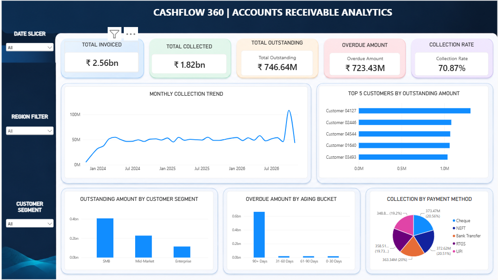
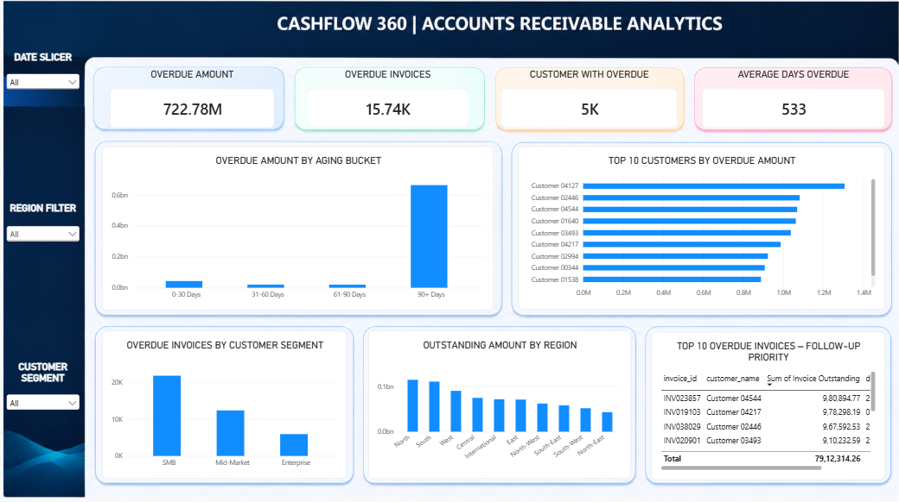
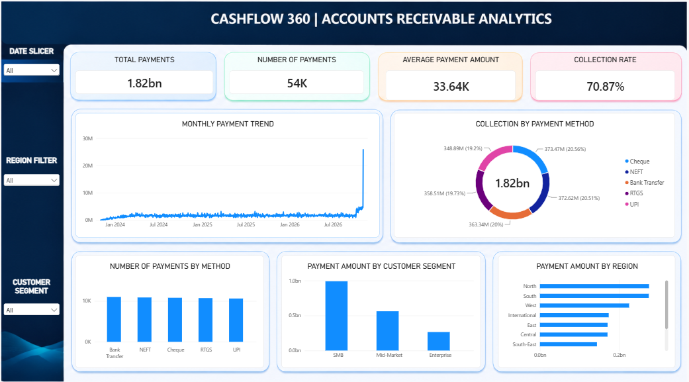

# CashFlow 360 – Accounts Receivable Analytics

### A SQL & Power BI Portfolio Project

An interactive Accounts Receivable Analytics solution built using **PostgreSQL and Microsoft Power BI** to analyze invoice aging, outstanding balances, customer payment behavior, and collection performance.

---

## 1. Project Overview

CashFlow 360 is a data analytics project focused on Accounts Receivable (AR) operations. It provides insights into invoice collections, overdue payments, customer balances, and payment trends through SQL-based analysis and an interactive three-page Power BI dashboard.

## 2. Business Problem

Businesses need to monitor outstanding invoices, identify overdue payments, and understand customer payment behavior to maintain healthy cash flow.

This project addresses these analytical requirements by organizing invoice and payment data and presenting actionable insights through SQL queries and Power BI visualizations.

## 3. Project Objectives

- Monitor total invoiced, collected, and outstanding amounts.
- Identify overdue invoices and analyze invoice aging.
- Identify customers with high outstanding balances.
- Compare collection performance across customer segments and regions.
- Analyze monthly payment trends and payment methods.
- Support collection follow-up prioritization through data insights.

## 4. Tools & Technologies

| Tool | Purpose |
|---|---|
| PostgreSQL | Data storage and SQL analysis |
| Microsoft Power BI | Dashboard development and visualization |
| SQL | Data analysis, aggregations and business queries |

## Dataset

The project uses a synthetically generated dataset for portfolio and analytical purposes. It contains four CSV files:

| File | Description |
|---|---|
| `customers.csv` | Customer details and segments |
| `invoices.csv` | Invoice and billing records |
| `payments.csv` | Customer payment transactions |
| `regions.csv` | Regional information |

- **Total Records:** 99,010
- **Format:** CSV files bundled in a ZIP archive
- **Dataset:** [Download CashFlow360 Dataset](CashFlow360_Dataset_Fixed.zip)

*Note: This is synthetic data and does not contain real customer or company information.*

## 5. Dashboard Preview

The Power BI dashboard contains three interactive report pages.

### Page 1 – Executive Overview

Key features:
- Total Invoiced, Total Collected and Outstanding Amount
- Overdue Amount and Collection Rate
- Monthly Collection Trend
- Top 5 Customers by Outstanding Amount
- Outstanding Amount by Customer Segment
- Overdue Amount by Aging Bucket
- Collection by Payment Method

### Page 2 – Invoice Aging & Customer Analysis

Key features:
- Overdue Amount and Overdue Invoice Count
- Average Days Overdue
- Top 10 Customers by Overdue Amount
- Overdue Invoices by Customer Segment
- Outstanding Amount by Region
- Top 10 Overdue Invoices for Follow-up Priority

### Page 3 – Payment & Collection Trends

Key features:
- Total Payments and Number of Payments
- Average Payment Amount
- Collection Rate
- Monthly Payment Trend
- Collection by Payment Method
- Payment Amount by Customer Segment and Region

### Interactive Filters

All three report pages include synchronized filters:
- Invoice Date
- Region
- Customer Segment

## 6. Key Business Insights

The following insights were observed with all dashboard filters set to their default values:

| KPI | Result |
|---|---:|
| Total Invoiced | ₹256.35 Cr |
| Total Collected | ₹181.68 Cr |
| Total Outstanding | ₹74.66 Cr |
| Collection Rate | 70.87% |
| Overdue Amount | Approximately ₹72.34 Cr |

Additional observations:

- The 90+ days aging bucket accounts for the largest share of overdue amounts.
- Customer-wise analysis helps identify accounts with high outstanding balances.
- Collection rates vary across customer segments and regions.
- Payment trends provide visibility into monthly collection activity.

## 7. SQL Analysis

PostgreSQL was used to perform business-focused analysis, including:

- Invoice and payment aggregations.
- Outstanding balance calculations.
- Overdue invoice identification.
- Invoice aging analysis.
- Customer-wise outstanding analysis.
- Region and customer segment comparisons.
- Payment method and monthly payment analysis.

**SQL file:** `CashFlow360_SQL_Analysis.sql`

## 8. Project Documentation

The Business Requirements Document (BRD) outlines the business problem, objectives, stakeholders, requirements, KPIs, functional requirements, data requirements, and expected outcomes.

**BRD:** `CashFlow360_BRD.pdf`

## 9. Repository Contents

| File | Description |
|---|---|
| `CashFlow360_BRD.pdf` | Business Requirements Document |
| `CashFlow360_SQL_Analysis.sql` | PostgreSQL analysis queries |
| `CashFlow360_AR_Analytics.pbix` | Interactive Power BI dashboard |
| `CASHFLOW_A.png` | Executive Overview screenshot |
| `CASHFLOW_B.png` | Invoice Aging & Customer Analysis screenshot |
| `CASHFLOW_C.png` | Payment & Collection Trends screenshot |

## 10. Dataset & Assumptions

- The dataset is synthetic and created solely for portfolio demonstration.
- It does not contain actual company or customer transactions.
- Business rules and follow-up priority thresholds are defined for analytical demonstration.
- Dashboard results may change when interactive filters are applied.

## 11. Expected Business Outcomes

- Better visibility into accounts receivable.
- Easier identification of overdue invoices.
- Improved understanding of customer payment patterns.
- Better monitoring of collection performance.
- Data-supported collection follow-up prioritization.

---

**Project:** CashFlow 360 – Accounts Receivable Analytics  
**Tools:** PostgreSQL | Microsoft Power BI  
**Project Type:** Data Analytics Portfolio Project
